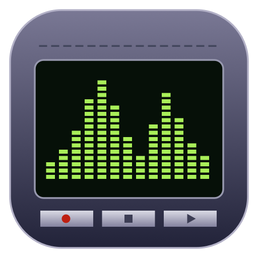
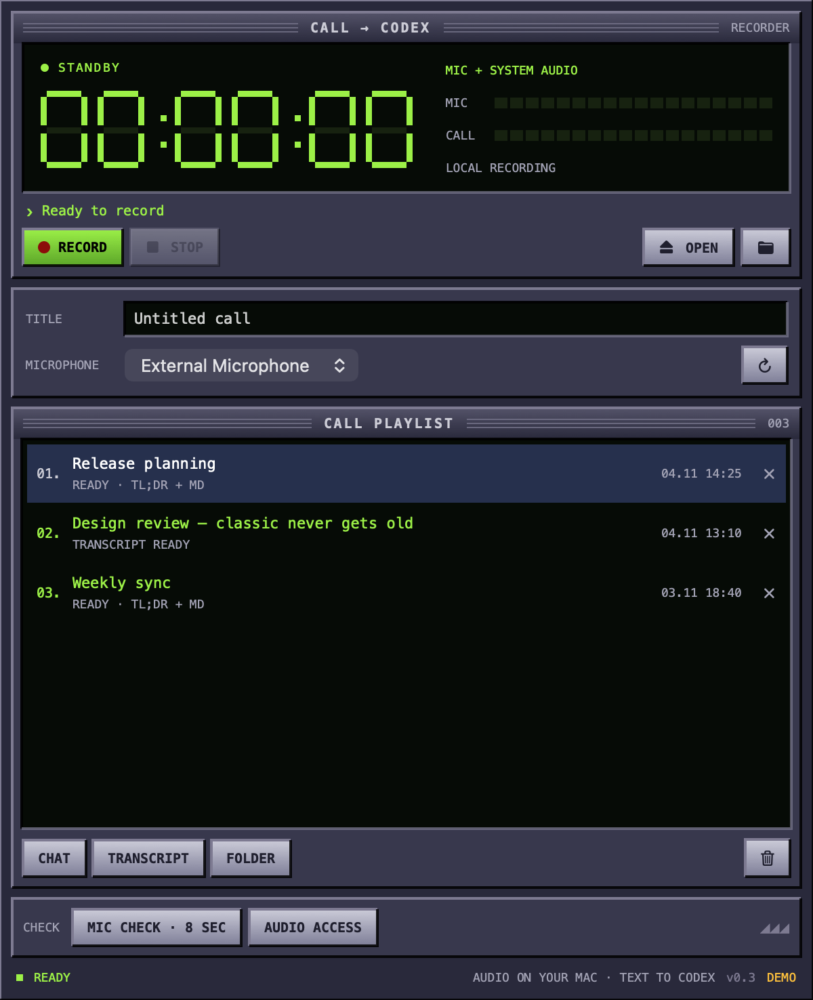
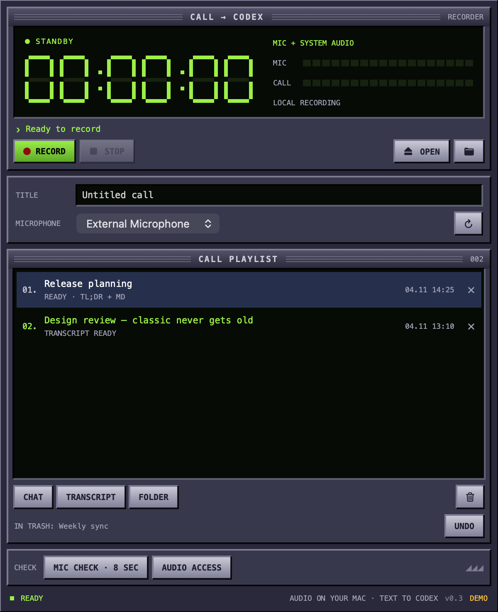

<p align="center">
  
</p>

<h1 align="center">CallToCodex</h1>
<p align="center"><strong>Press record. Get the gist. Keep the conversation.</strong></p>
<p align="center">A tiny native Mac call recorder with a classic, Winamp-inspired interface.<br>Local transcription → a fresh Codex chat with a TL;DR and a Markdown transcript.</p>

<p align="center">
  <a href="https://github.com/ansvier/call-to-codex/releases/tag/v0.3.1">Download for Mac</a> ·
  <a href="#getting-started">Getting started</a> ·
  <a href="#build-from-source">Build from source</a>
</p>
<p align="center">
  <a href="https://github.com/ansvier/call-to-codex/actions/workflows/ci.yml"></a>
  
  
  <a href="LICENSE"></a>
</p>

<p align="center">
  
  
</p>
<p align="center"><sub>Actual app screenshots with synthetic demo calls.</sub></p>

## What it does

- Records your microphone and the Mac's system audio, independently of the meeting app.
- Detects speech locally with Silero VAD, then transcribes it with bundled whisper.cpp and Whisper large-v3-turbo Q5.
- Sends the transcript text to Codex and creates a separate chat for each call.
- Produces a short summary in the conversation's language, plus a timestamped `transcript.md`.
- Keeps a call playlist with shortcuts to the chat, transcript and local folder.
- Moves deleted calls to macOS Trash, with Undo for the last deletion.
- Imports existing audio or video recordings that macOS can decode.

No meeting bot, browser extension, Python, FFmpeg or separate transcription service is required. The downloadable app includes the speech model, so the archive is about 550 MB.

## Getting started

**Requirements:** an Apple Silicon Mac, macOS 15 or later, and a signed-in Codex installation. The app also recognizes the Codex CLI bundled with the ChatGPT desktop app. A separately installed `codex` CLI works too.

1. Download the **DMG** from [Releases](https://github.com/ansvier/call-to-codex/releases/tag/v0.3.1), open it and drag **CallToCodex** into **Applications**.
2. Launch it from Applications. This early release is ad-hoc signed and **not notarized by Apple**. macOS may block the first launch; if you trust this download, follow Apple's [Open Anyway instructions](https://support.apple.com/en-us/102445). Future Developer ID signing and notarization are still pending.
3. Allow **Microphone** and **Screen & System Audio Recording** in System Settings → Privacy & Security. Quit and reopen CallToCodex after changing system audio permission.
4. Choose your microphone. **MIC CHECK · 8 SEC** tests your voice without saving audio; **AUDIO ACCESS** checks the system capture permission.
5. Optionally enter a title, then press **RECORD**. Watch both level meters. Press **STOP** when the call ends.

The app saves the recording, transcribes locally, then opens its new Codex chat when the summary is ready. **CHAT**, **TRANSCRIPT** and **FOLDER** reopen the results later. Closing the window keeps the app running in the menu bar.

Codex needs an internet connection and uses your existing Codex sign-in and usage limits. No OpenAI API key is requested by CallToCodex.

## Your audio, on your Mac

```text
Microphone + system audio
          ↓
Local audio files → native audio preparation → local Whisper
                                                   ↓
                                            transcript.md
                                                   ↓ text
                                            New Codex chat
                                                   ↓
                                        TL;DR + transcript link
```

The app does not upload the audio. It passes transcript text to the Codex CLI for the summary, where your Codex account's data settings apply. The app has no analytics or hosted backend. A transcript link in the chat points to a local Markdown file; it is not a hosted attachment.

Calls are stored in:

```text
~/Library/Application Support/CallToCodex/Recordings/
```

Each call folder contains source tracks or the imported file, a mixed `audio.wav`, recognition output, the Markdown transcript, summary, metadata and diagnostic logs. These files can contain the full conversation. The app does not automatically expire them. Newly created call folders are private to your macOS user.

Deleting a call moves its whole local folder to Trash. **UNDO** restores the last deletion during that app session; older deletions can be recovered from Finder's Trash. Its Codex chat remains and can be managed in Codex separately.

## A few practical limits

- System capture includes other app audio that plays during the recording, such as notifications. It does not save screen images.
- Transcription uses the mixed track. There is no speaker diarization or reliable speaker labeling yet.
- Recognition is automatic and may miss words or invent phrases. Local speech detection reduces hallucinations from silence, but cannot eliminate them, especially with background voices or overlapping speech. Check the transcript for important details.
- Intel Macs are not supported by the downloadable build. The current UI is English; spoken language and summaries can be multilingual.
- Direct Codex integration depends on its installed CLI and desktop chat links. A future Codex update may require an app update.

If Codex is unavailable, the local transcript is retained. Sign in, check the connection and use the selected call's **retry** button. See [troubleshooting](docs/TROUBLESHOOTING.md) for permission and audio issues.

## Build from source

Use an Apple Silicon Mac with Xcode Command Line Tools and CMake:

```bash
git clone https://github.com/ansvier/call-to-codex.git
cd call-to-codex
./scripts/test.sh
./scripts/build.sh
```

The build downloads the pinned whisper.cpp source and speech models, verifies their SHA-256 checksums, compiles the native app and processor, and creates:

```text
dist/CallToCodex.app
dist/CallToCodex-0.3.1-macOS-arm64.dmg
dist/CallToCodex-0.3.1-macOS-arm64.zip
dist/SHA256SUMS.txt
```

After building, `./scripts/test-transcription.sh` checks speech detection, quiet background noise and timestamps against the public JFK sample from the whisper.cpp source checkout.

On headless runners, `CALLTOCODEX_TEST_CPU_ONLY=1 CALLTOCODEX_TEST_QUIET_ONLY=1 ./scripts/test-transcription.sh` runs the noise-only regression without GPU acceleration. The signed app bundle is left untouched.

The default signature is ad-hoc. `CALLTOCODEX_SIGN_IDENTITY` can select an installed Developer ID identity for the app signature; notarization is a separate release step. Caches live in `.cache/` and build files in `.build/`. `CALLTOCODEX_CMAKE` and `CALLTOCODEX_CACHE_DIR` can override the tool and cache locations.

`./scripts/demo.sh` opens a separate preview with synthetic calls for documentation screenshots. Its recording button does not capture audio. The preview exports its first window image automatically; **Save Demo Screenshot** in its app menu exports another. Real call history is not used.

## Project

Native SwiftUI/AppKit interface, ScreenCaptureKit system audio, AVCaptureSession microphone and AVFoundation audio conversion. The processor streams decoding and mixing in chunks, preserving the start offset between microphone and system audio. See [Sources](Sources) and the [native audio checks](Tests/AudioTests.swift).

Bug reports and pull requests are welcome. Please describe your macOS version, Mac chip, input device and the step that failed. Avoid attaching real recordings, transcripts or unredacted diagnostic logs to public issues.

## License & credits

CallToCodex is [MIT licensed](LICENSE). The bundled [whisper.cpp](https://github.com/ggml-org/whisper.cpp) engine, [OpenAI Whisper](https://github.com/openai/whisper) model and [Silero VAD](https://github.com/snakers4/silero-vad) model are MIT licensed too; see [third-party notices](THIRD_PARTY_NOTICES.md).

An independent project inspired by classic desktop audio players. Not affiliated with OpenAI or Winamp. The app icon and interface artwork are original.
